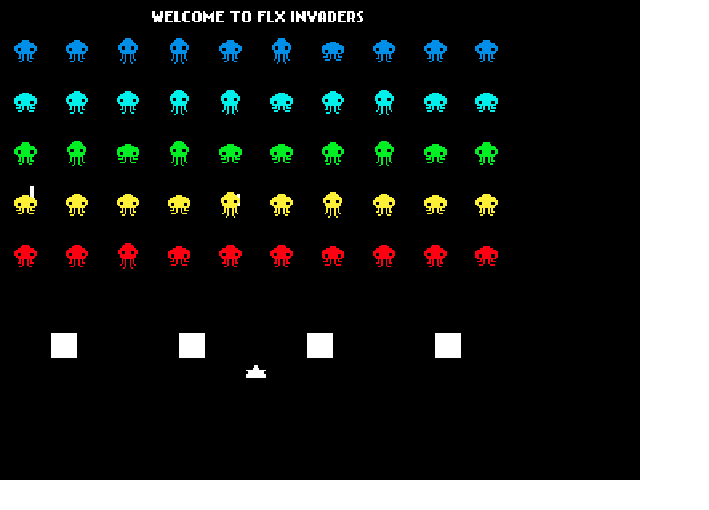

# BaoFlashBrowser · Chromium 140 上的原生 PPAPI Flash

> **在 Chromium 140 / Electron 38 的单内核里，跑通原生 PPAPI Flash，并渲染出真实 Flash 游戏。**
> 不是双内核，不是 Ruffle，不是 CEF 外挂——是同一个 Electron 进程里跑的原生 Flash 插件。



*`FlxInvaders.swf`（68 KB ActionScript 游戏）在自建 Electron 38 / Chromium 140 中的实际渲染结果。*

---

## 这是什么

Chromium 在 **138 是最后一个带原生 PPAPI 的版本**，140 把 `ppapi/`、`content/renderer/pepper/`、
`content/ppapi_plugin/` 以及 Flash 专用接口**全部删除**。

本仓库是"把它们搬回来并重新接线"的完整成果与复现材料：

| 内容 | 说明 |
| --- | --- |
| `patches/140-port.patch` | Chromium 140 / Electron 38 的完整移植补丁（1782 文件 / 286 853 行新增） |
| `patches/138-port.patch` | Chromium 138 / Electron 37 基线补丁（83 文件） |
| `manifests/` | 变更清单（name-status / numstat）与 13 个关键文件 SHA-256 |
| `scripts/restore-140.ps1` | 从干净 Chromium 140 树 + 补丁恢复出可编译工作树 |
| `scripts/verify-140.ps1` | 校验恢复结果（哈希 / 目录规模 / 关键符号） |
| `docs/140-ppapi-revival-ai-guide.md` | **面向 AI 的 140 二次实现说明书**（16 阶段 + 25 条错误字典 + harness） |
| `docs/forward-version-feasibility.md` | 138→140/142/144/150 可行性实测与完整历程（§1.14.11 = 最终状态） |
| `docs/preservation-plan.md` | 代码保存方案（本地快照 / 补丁归档 / 远程 fork / 冷备） |
| `docs/blog/` | 两篇对外分享（138 那次、138→140 这次） |

---

## 已验证的结论

| 项 | 值 |
| --- | --- |
| Chromium | `140.0.7339.41` |
| Electron | `v38.0.0` |
| Flash | `29.0.0.171`（原生 PPAPI，win64） |
| 出帧 | ✅ `FlxInvaders.swf` 完整渲染，`interactiveFrames=3`，三次截图 digest 各不相同 |
| 基线对照 | Chromium 138 / Electron 37（`bao/138-verified`），同样出帧 |
| 规模 | 1662 个文件搬运（其中 581 个按 140 API 适配）+ 63 个既有文件修改 |
| 耗时 | 约 2.2 天 / 18–20 工时 |

**Flash 34.0.0.380（国内魔改版）注意**：能初始化、能出图，但带 **EOL 时间炸弹**（"当前版本不再受支持"）。
推荐用 29.0.0.171。详见 `docs/blog/2026-11-17-138-to-140.md`。

---

## 两个关键坑（文档里有完整推导）

1. **`Make()` 收到空的 `ClientSharedImage`** —— 140 把 `MakeGpu(mailbox…)` 合并成 `Make(shared_image…)`，
   而 138 的调用点在这一行之前已经把 `shared_image` `std::move` 进释放回调了。修法一行：move 前先留一份。
2. **Flash 只画一帧白就不动了** —— 140 删了 `WebLocalFrameClient::DidCommitAndDrawCompositorFrame`，
   `ViewInitiatedPaint()` 不再被调用 → 不发 `Graphics2D FlushAck` → Flash 停在第一帧。
   临时方案在 `PrepareTransferableResource()` 里发 ack；终态方案见可行性文档 §1.14.11（A/B/C 评估）。

---

## 快速开始（复现）

```powershell
# 1) 取干净源码（必须是同一个 base commit）
git clone --no-checkout https://chromium.googlesource.com/chromium/src.git D:\cr140
cd D:\cr140
git checkout 84e1454fbb49226f0b2b0de01343417681d9af10
gclient sync --no-history     # .gclient 需同时挂 chromium/src 与 electron/src

# 2) 打补丁
git apply --3way D:\port-archive\patches\140-port.patch

# 3) 校验
pwsh -File .\scripts\verify-140.ps1 -Src D:\cr140

# 4) 构建
gn gen out/Testing --args='import("//electron/build/args/testing.gn") enable_plugins=true symbol_level=1'
ninja -C out/Testing -j 6 electron      # 内存有限时 -j 6 是上限
```

运行验证的关键参数（`#` 与 `;` 必须留在引号内）：

```bat
electron.exe --allow-command-line-plugins ^
  "--register-pepper-plugins=<path>\pepflashplayer64.dll#Shockwave Flash#Shockwave Flash 29.0 r0#29.0.0.171;application/x-shockwave-flash#swf#spl" ^
  --enable-logging --log-file=chrome.log app_dir
```

判定：`chrome.log` 出现 `initialize_module returned 0`；截图出现真实 SWF 内容；`interactiveFrames >= 2`。

---

## 代码镜像

完整源码快照（fork，分支可直接 clone）：

- Chromium 140 / Electron 38 移植：`git clone -b bao/140-verified https://github.com/Sutanm/chromium.git`
- Chromium 138 / Electron 37 基线：`git clone -b bao/138-verified https://github.com/Sutanm/chromium.git`

> fork 只是代码镜像，会带上游全部历史与分支；**本仓库才是成果展示 + 复现材料的入口**。

---

## 许可与合规

- Chromium 源码为 BSD-3-Clause，补丁可自由分发。
- **不含 Flash 插件二进制**（`pepflashplayer*.dll`）。只记录版本号与加载参数。
